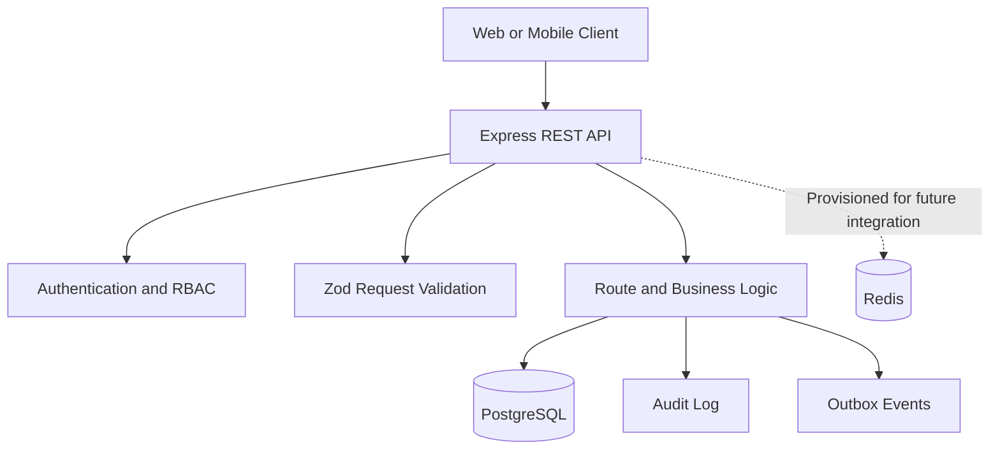

# Amrutam Telemedicine API — Architecture

## 1. Overview

The application is a TypeScript REST API built with Express. It provides patient authentication, doctor availability management, consultation booking and lifecycle operations, and prescriptions. PostgreSQL is the primary persistent datastore.

## 2. High-Level Architecture

## 3. Main Components

- **Express API:** HTTP routing, middleware, error handling, and security headers.
- **Authentication:** JWT access tokens, hashed refresh-token storage, token rotation, role-based authorization, and optional TOTP multi-factor authentication.
- **Validation:** Zod schemas validate request payloads before business logic runs.
- **PostgreSQL / Prisma:** Relational persistence and database transactions.
- **Audit records:** Important authentication and consultation operations create audit entries.
- **Idempotency:** Consultation booking accepts an `Idempotency-Key` and records the request/result to reduce duplicate bookings.
- **Outbox:** Booking creates an outbox event in the same transaction to support reliable downstream processing when a worker is implemented.
- **Redis:** Provisioned in Docker Compose. Application caching and distributed coordination require additional integration.

## 4. Consultation Booking Flow

1. The patient authenticates and sends a booking request with an idempotency key.
2. The API validates the request and checks for an existing idempotency record.
3. A database transaction verifies slot availability and doctor eligibility.
4. The slot is conditionally marked as booked.
5. The consultation, idempotency record, audit record, and outbox event are persisted in the transaction.
6. The API returns the booking result.

The database transaction and conditional slot update help prevent two requests from booking the same slot. Production workloads should also include bounded retry handling for serialization conflicts and concurrency tests.

## 5. Security

- Passwords are hashed using bcrypt.
- MFA uses time-based one-time passwords (TOTP); MFA secrets are encrypted before storage using `MFA_ENCRYPTION_KEY`.
- When MFA is enabled, login requires a valid authenticator code before tokens are issued. Enabling MFA also revokes existing refresh tokens.
- Access tokens are signed JWTs; refresh tokens are stored as hashes and rotated on refresh.
- Protected routes enforce roles and resource ownership.
- Request payloads use schema validation.
- Helmet applies HTTP security headers.
- Authentication endpoints have rate limiting.
- Sensitive configuration belongs in environment variables or a managed secret store.
- Production deployments should use HTTPS, managed secrets, database encryption and backups, alerting, and least-privilege network and database access.

## 6. Reliability and Observability

- `/health/live` checks whether the API process responds.
- `/health/ready` checks database connectivity.
- Pino provides structured HTTP logging.
- Database transactions protect related booking writes.
- The outbox table provides a foundation for reliable asynchronous event processing; a worker and retry/dead-letter strategy are separate implementation tasks.

## 7. Testing and Delivery

Local verification includes TypeScript type checking, automated tests, and a production build. Automated tests cover health checks, unauthenticated consultation access, MFA secret encryption and tamper detection, TOTP validation, and login enforcement. Additional tests should cover token rotation, role and ownership checks, booking idempotency, concurrent slot booking, consultation lifecycle transitions, prescription authorization, and failure handling.

## 8. Current Limitations

This implementation is an assignment-level backend and is not yet a production-certified telemedicine platform. Email verification, background outbox processing, distributed rate limiting, production metrics/alerting integration, production deployment infrastructure, and load testing should be treated as outstanding unless separately implemented and verified.

The stated availability and latency targets require deployment-level redundancy, monitoring, capacity planning, and load testing before they can be claimed as achieved.
